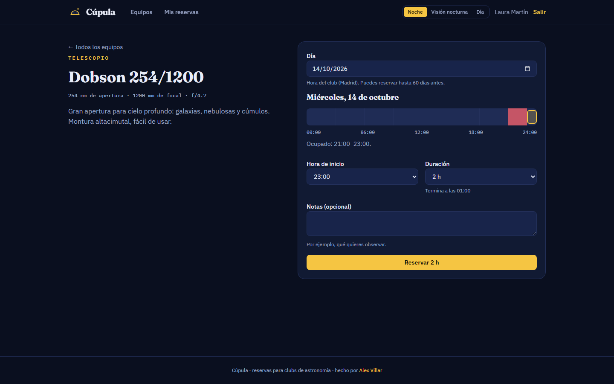
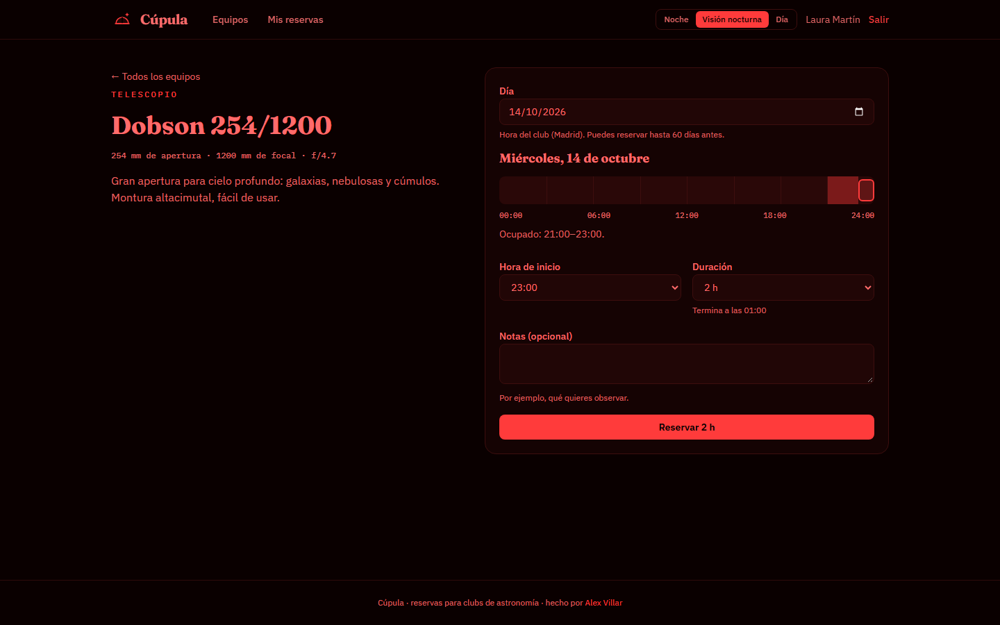
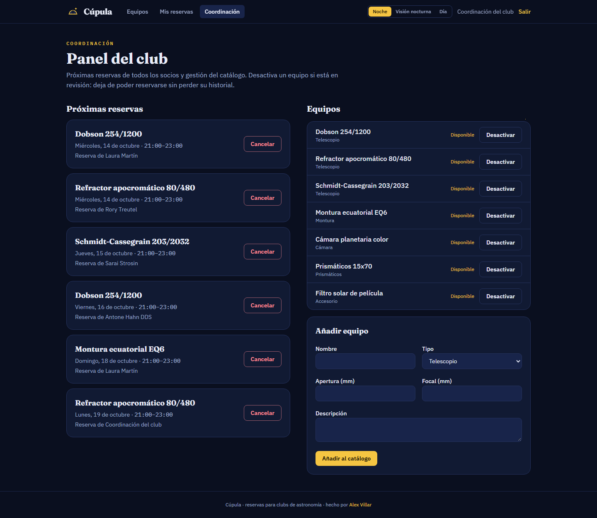
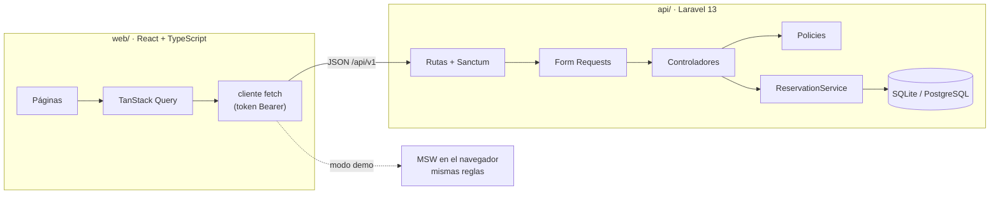

# Cúpula

**Reservas de telescopios y equipo para clubs de astronomía.** Los socios ven cuándo está libre cada equipo y lo reservan sin pisarse; la coordinación del club gestiona el catálogo y todas las reservas.

API REST en **Laravel 13** + frontend en **React 19 con TypeScript**, con reglas de negocio reales: franjas horarias, solapes, límites por socio, zonas horarias y roles.

**[Probar la demo →](https://alexyz17.github.io/cupula/)** · [Documentación de la API (OpenAPI)](docs/openapi.yaml)

[](https://github.com/Alexyz17/cupula/actions/workflows/ci.yml)

> La demo no necesita servidor: la API se simula en el navegador con [MSW](https://mswjs.io/) y aplica las mismas reglas que Laravel. Cuentas de prueba: `socia@cupula.test` y `admin@cupula.test`, contraseña `cupula2026`.



| Modo visión nocturna | Panel de coordinación |
| --- | --- |
|  |  |

## Qué demuestra este proyecto

| Área | Implementación |
| --- | --- |
| API REST | Rutas versionadas (`/api/v1`), Form Requests, API Resources, paginación y filtros, errores JSON en español |
| Autenticación | Tokens de Laravel Sanctum, límite de intentos en login y registro, mismo error para email inexistente y contraseña incorrecta |
| Autorización | Policies por recurso; el rol no se puede asignar desde el registro (`role` no es *fillable*) |
| Reglas de negocio | Centralizadas en `ReservationService`: franjas de 30 min, de 30 min a 6 h, hasta 60 días de antelación, máximo 3 reservas activas por socio, sin solapes |
| Concurrencia | La reserva se crea en una transacción que bloquea la fila del equipo (`lockForUpdate`): dos peticiones simultáneas para la misma franja no pueden entrar las dos |
| Fechas | Todo se guarda en UTC; la disponibilidad se calcula por días del calendario del club (Europe/Madrid), cambios de hora incluidos |
| Privacidad | La disponibilidad no dice quién reservó y las reservas nunca exponen el email de otros socios |
| Frontend | React 19, TypeScript, TanStack Query, React Router, Tailwind CSS 4; enlaces compartibles a un día concreto (`?dia=AAAA-MM-DD`) |
| Experiencia | Propone la primera franja libre de la noche y avisa de un solape antes de enviar; el servidor sigue siendo quien decide |
| Accesibilidad | Todos los campos con etiqueta, errores anunciados a lectores de pantalla (`role="alert"`), foco visible, contraste AA en los tres temas y respeto a `prefers-reduced-motion` |
| Tests | 46 tests de Pest en la API y 20 de Vitest + Testing Library en el frontend, que usan la misma API simulada que la demo |
| Calidad y entrega | CI en GitHub Actions (Pint, Pest, oxlint, Vitest, build) y despliegue automático de la demo en GitHub Pages |

## Arquitectura



- **Controladores finos.** Validan el formato de la petición y delegan. Lo que depende del estado del club (solapes, límites, horarios) se decide en `app/Services/ReservationService.php`.
- **Reglas configurables.** `config/cupula.php` y variables de entorno, sin tocar código.
- **Una sola fuente de verdad para la demo y los tests.** `web/src/mocks/handlers.ts` implementa la API con las mismas reglas; la demo pública la usa en el navegador y los tests del frontend, en Node.

## Reglas del club

1. Las reservas empiezan y terminan en franjas de 30 minutos.
2. Duran entre 30 minutos y 6 horas, y se pueden hacer con hasta 60 días de antelación.
3. Un socio puede tener 3 reservas futuras confirmadas a la vez; la coordinación no tiene límite.
4. Un equipo no puede tener dos reservas que se solapen. Dos franjas contiguas (una acaba a las 22:00 y otra empieza a las 22:00) sí son compatibles.
5. Solo se cancela una reserva antes de que empiece, y solo puede hacerlo quien la hizo o la coordinación.
6. Un equipo con reservas pendientes no se puede borrar: se desactiva y deja de poder reservarse sin perder su historial.

## Puesta en marcha

Requisitos: PHP 8.4, Composer y Node.js 24.

```bash
# API: http://localhost:8000
cd api
composer install
cp .env.example .env
php artisan key:generate
php artisan migrate --seed      # club de ejemplo con equipos, socios y reservas
php artisan serve

# Frontend: http://localhost:5173
cd web
npm install
npm run dev                     # contra la API local
npm run dev:demo                # sin servidor, con la API simulada
```

Cuentas del club de ejemplo: `socia@cupula.test` y `admin@cupula.test`, contraseña `cupula2026`.

```bash
cd api && vendor/bin/pest && vendor/bin/pint --test
cd web && npm test && npm run lint && npm run build
```

## Decisiones técnicas

- **Tokens Bearer y no cookies de sesión.** API y frontend se despliegan por separado; con tokens no hace falta compartir dominio ni gestionar CSRF, y CORS solo admite el origen configurado en `FRONTEND_URL`.
- **El servidor manda.** El frontend avisa de solapes y horas pasadas para no hacer perder el tiempo, pero cada regla se vuelve a comprobar en la API.
- **Demo sin coste y siempre en línea.** Un backend gratuito se duerme o borra los datos; con MSW la demo muestra el producto completo desde GitHub Pages, y los datos de cada visitante se quedan en su navegador.
- **Modo visión nocturna.** En observación se usa luz roja para no perder la adaptación del ojo a la oscuridad; la interfaz ofrece ese tema además del claro y el oscuro.

## Licencia

[MIT](LICENSE) · Hecho por [Alex Villar Gracia](https://alexvillar10.gitlab.io/).
